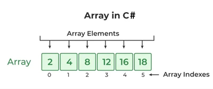
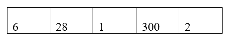
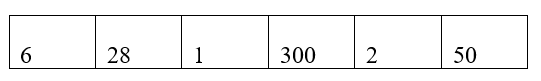
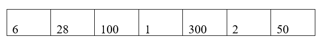
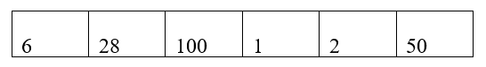
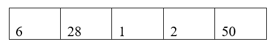
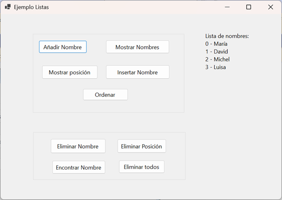

   

<br>
<br>

# Tema 6. Colecciones de Datos 

[*1.	Introducción*](#_apartado1)

[*2.	Arrays unidimensionales o vectores*](#_apartado2)

[*3.	Métodos de búsqueda y ordenación*](#_apartado3)

[*4.	Cadenas de caracteres o Strings*](#_apartado4)

[*5.	Ejemplo con vectores de strings y ordenación*](#_apartado5)

[*6.	La clase List*](#_apartado6)

[*7.	Ejemplos con List*](#_apartado7)

<br>

# <a id="_apartado1"></a>1. Introducción.

Hasta el momento los tipos de datos que hemos visto ya sean **int, double, bool o char** nos permiten definir variables en las que solamente puede almacenarse un valor en un momento dado. Determinados problemas requieren grandes grupos de datos que formen por sí mismos una colección o estructura. Para poder definir estas estructuras los lenguajes de programación nos ofrecen unos tipos de datos más complejos basados en los tipos de datos simples que existen en el lenguaje.

En la primera parte de este tema estudiaremos los **arrays** (centrándonos en los arrays unidimensionales o **vectores**), y en la segunda parte trabajaremos con las **listas** en C#.

La principal **diferencia** entre los vectores y las listas es que los vectores serán estáticos, es decir, su tamaño será fijo, mientras que las listas nos permitirán trabajar con colecciones dinámicas de datos que podrán cambiar su tamaño en tiempo de ejecución.

<br>
<br>

# <a id="_apartado2"></a>2. Arrays unidimensionales o vectores.

Los arrays surgen de la necesidad de tratar **conjuntos de datos del mismo tipo** relacionados. Tendremos una lista de elementos del mismo tipo. Accederemos a estos datos mediante un nombre común y un índice que indicará qué elemento del array o vector utilizamos.

Un **array** es una estructura homogénea de datos, de tamaño constante, y accedemos a sus elementos mediante un identificador común y uno o varios índices.

Así, las características de los arrays son:

- **Homogéneo**, todos sus datos son del mismo tipo.
  
- **Tamaño constante**: su número de elementos es el mismo a lo largo de toda la ejecución del programa.
  
- Accedemos a sus elementos mediante el identificador o **nombre** del array y mediante un **índice** (debe ser un entero). 
  
- La **dimensión** indica el número de índices necesarios para acceder a un elemento.
  
Así mediante un array podremos definir: un conjunto de números enteros, o un conjunto de reales, o una cadena de caracteres o una matriz (dos dimensiones) o una lista de registros...



<br>

- **Declaración del Vector o Array Unidimensional.**

Para declarar un vector se utiliza la misma notación que para declarar una variable simple. Primero se especifica el tipo y a continuación el nombre de la variable seguido de un punto y coma. Para declarar el tipo de la variable como tabla se emplean corchetes. 

Al declarar una variable de tabla no se especifica el tamaño de la tabla. Se le dará tamaño con la instrucción `new`.

La sintaxis para declarar un array (de momento vamos a definir un vector de una única dimensión) en Visual C# es la siguiente:

```csharp
tipo [ ] nombreVector;
```

- **Tamaño de la tabla.**
  
El tamaño del vector se da mediante la instrucción `new`. Se puede hacer en el momento de la declaración o en otro punto del código, pero siempre antes de acceder a los elementos del vector.

```csharp
tipo [] nombreVector = new tipo [Tamaño];
```

- **Acceso a los componentes del vector.**
  
Nosotros podemos acceder a los elementos individuales de un array y utilizarlos como si fueran una variable normal, es decir podemos asignarles un valor o recoger su valor, operar con ellos ...

Cada componente del ARRAY se designa utilizando el nombre de la variable del tipo ARRAY seguida de la posición o índice escrito entre corchetes.

```csharp
nombreVector[índice]
```

Importante tener en cuenta que los elementos de un vector en Visual C# van desde **0 al número de elementos - 1**. Es decir, un vector de tamaño 10 tiene los elementos **0, 1, 2, 3, 4, 5, 6, 7, 8 y 9**.

Existe una función `Length` que nos devuelve el número de elementos que tiene el vector. En el caso anterior nos devolvería 10.

<br>

**Ejemplo.** Realizar en un botón la lectura de un vector de 5 números enteros y una vez leídos que se impriman por pantalla.

```csharp
const int Tam = 5;

// Declaramos y damos tamaño al vector.
int[] vector = new int[Tam];
int i;

// Leemos todos los elementos del vector.
for (i = 0; i < Tam; i++)
{
    vector[i] = int.Parse(InputBox("Introduzca el elemento: " + i));
}

// Mostramos los elementos del vector.
for (i = 0; i < Tam; i++)
{
    MessageBox.Show("Vector[" + i + "] = " + vector[i]);
}
``` 
<br>

Debemos tener en cuenta que a la hora de recorrer los elementos del vector podemos utilizar `Tam` que es la constante que nos indica el tamaño del vector o bien `vector.Length()`. 

<br>

**Ejemplo.** Lectura y escritura de un vector utilizando programación modular.

```csharp
const int Tam = 5;

// Declaramos y damos tamaño al vector.
int[] vector = new int[Tam];

void LeerVector(int[] vector)
{
    int i;

    // Leemos todos los elementos del vector.
    for (i = 0; i < vector.Length; i++)
    {
        vector[i] = int.Parse(InputBox("Introduzca el elemento: " + i)); 
    }
}

string MostrarVector(int[] vector)
{
    string texto;
    int i;

    texto = "Elementos del vector: \n";
    for (i = 0; i < vector.Length; i++)
    {
    	texto = texto + vector[i] + ", ";
    }

    return texto;
}


private void btnLeer_Click(object sender, EventArgs e)
{
    LeerVector(vector);
}


private void btnMostrar_Click(object sender, EventArgs e)
{
    string texto;

    texto = MostrarVector(vector);

    MessageBox.Show(texto);
}
```

<br>

**Nota:** Notemos que en este y ejemplos posteriores **el vector se declara fuera de los botones**. Esto es así porque leemos el vector en un botón y lo mostramos en otro. Si lo declaráramos dentro del botón su ámbito de utilización sería ese botón y por tanto no podríamos acceder a él desde el botón de escritura. 

Sin embargo, en las funciones de `leerVector` y `mostrarVector` es importante que **pasemos por parámetros el vector** que queremos utilizar.

<br>

**Ejemplo.** Tenemos un vector con las notas de los alumnos de DAW y les aumentaríamos a todos un punto.

```csharp
const int NumAlumnos = 35;
int[] notasDAW = new int[NumAlumnos];

... 

for(i = 0; i < NumAlumnos; i++)
{
    notasDAW[i] = notasDAW[i] + 1;
}
```

<br>

**Ejemplo.** Realizar un programa que lea 10 números enteros y una vez leídos divida la suma total por el número que se introdujo en la posición pos siendo pos un número introducido por el usuario.

```csharp
const int Tam = 10;

// Declaramos y damos tamaño al vector.
int[] vector = new int[Tam];

void LeerVector(int[] vector)
{
    int i;

    // Leemos todos los elementos del vector.
    for (i = 0; i < vector.Length; i++)
    {
         vector[i] = int.Parse(InputBox("Introduzca el elemento: " + i));
    }
}


string MostrarVector(int[] vector)
{
    string texto;
    int i;


    texto = "Elementos del vector: \n";
    for (i = 0; i < vector.Length; i++)
    {
        texto = texto + vector[i] + ", ";
    }

    return texto;
}

// Subprograma que devuelve la suma de todos los elementos del vector.
int SumaVector(int[] vector)
{
    int suma, i;

    suma = 0;
    for (i = 0; i < vector.Length; i++)
    {
        suma = suma + vector[i];
    }

    return suma;
}

private void btnLeer_Click(object sender, EventArgs e)
{
    LeerVector(vector);
}

private void btnMostrar_Click(object sender, EventArgs e)
{
    string texto;

    texto = MostrarVector(vector);

    MessageBox.Show(texto);
}


private void btnDividirPos_Click(object sender, EventArgs e)
{
    int pos, suma;

    pos = int.Parse(InputBox("Introduzca la posición a dividir."));

    if (pos >= 0 && pos < vector.Length)
    {
        suma = SumaVector(vector);
        MessageBox.Show("Resultado: " + suma / vector[pos]);

    }
    else
    {
        MessageBox.Show("La posición sale de los límites del vector.");
    }
}
```

<br>

Es muy importante que, al trabajar con arrays, siempre controlemos **no salirnos de los límites del vector**. Por ejemplo, si al leer el vector en el ejemplo anterior hubiéramos hecho:

```csharp
    for (i = 0; i <= vector.Length; i++)
    {
        vector[i] = int.Parse(InputBox("Introduzca el elemento: " + i)); 
    }
```

Estaríamos recorriendo desde el elemento 0 hasta el 10, cuando solo tenemos desde el 0 hasta el 9 y nos daría un error de ejecución.

[https://docs.microsoft.com/es-es/dotnet/csharp/programming-guide/arrays/single-dimensional-arrays](https://docs.microsoft.com/es-es/dotnet/csharp/programming-guide/arrays/single-dimensional-arrays)


<br>

**Ejemplo.** Vamos a ver un sencillo ejemplo en **Consola** en el que simplemente leemos un vector de enteros y lo mostramos:

```csharp
static int LeerEntero(string mensaje)
{
    int num;
    bool correcto;

    do
    {
        Console.Write(mensaje);
        // Si lo que leemos no es un entero devuelve false
        correcto = int.TryParse(Console.ReadLine(), out num);

        if (!correcto)
        {
            Console.WriteLine("El texto introducido no es un entero correcto.");
        }

    } while (!correcto);
    // Continuamos pidiendo el número mientras no sea correcto

    return num;
}

static void LeerVector(int[] vector)
{
    int i;

    // Leemos todos los elementos del vector.
    for (i = 0; i < vector.Length; i++)
    {
        vector[i] = LeerEntero($"Introduzca el valor {i}:");
    }
}

static string MostrarVector(int[] vector)
{
    string texto;
    int i;

    texto = "Elementos del vector: \n";
    for (i = 0; i < vector.Length; i++)
    {
        texto = texto + vector[i] + ", ";
    }

    return texto;
}

const int Tam = 10;
static void Main(string[] args)
{
    int[] numeros = new int[Tam];

    LeerVector(numeros);

    Console.WriteLine();
    Console.WriteLine(MostrarVector(numeros));
}
```

<br>

**Ejemplo.** Vamos a ver otro programa algo más complejo, también en **Consola**, en el que haremos una **clase estática** que contendrá todos los métodos que luego utilizamos en nuestro programa principal.

Nuestro programa pretende leer las notas finales de un alumno en una lista de asignaturas.
Esta sería nuestra clase estática **Funciones**:

```csharp
static class Funciones
{
    // Función para leer un entero
    public static int LeerEntero(string mensaje)
    {
        int nota;
        bool correcto;

        do
        {
            Console.Write(mensaje);
            // Si lo que leemos no es un entero devuelve false
            correcto = int.TryParse(Console.ReadLine(), out nota);

            if (!correcto)
            {
                Console.WriteLine("El texto introducido no es un entero correcto.");
            }

        } while (!correcto);
        // Continuamos pidiendo el número mientras no sea un entero

        return nota;
    }

    static public void LeerNotas(int[] vector)
    {
        int i;

        // Leemos todos los elementos del vector.
        for (i = 0; i < vector.Length; i++)
        {
            do
            {
                vector[i] = LeerEntero($"Introduzca la nota {i} (entre 0 y 10):");
            } while (vector[i] < 0 || vector[i] > 10);
        }
    }

    static public string MostrarNotas(int[] vector)
    {
        string texto;
        int i;

        texto = "Notas: \n";
        for (i = 0; i < vector.Length; i++)
        {
            texto = texto + vector[i] + ", ";
        }

        return texto;
    }

    // Función que aumenta en 1 el valor de cada elemento del vector
    static public void AumentarNotas(int[] vector)
    {
        for(int i= 0; i < vector.Length; i++)
        {
            if(vector[i] + 1 <= 10) // Si la suma es mayor que 10 ponemos 10
            {
                vector[i]++;
            }
            else
            {
                vector[i] = 10;
            }
        }
    }

    static public double CalcularNotaMedia(int [] vector)
    {
        double media = 0.0;

        for(int i = 0; i < vector.Length; i++)
        {
            media += vector[i];
        }

        return media / vector.Length;
    }

    static public int Menu()
    {
        int opc;

        Console.WriteLine("\nMenú.");
        Console.WriteLine("1. Introducir todas las notas.");
        Console.WriteLine("2. Mostrar todas las notas.");
        Console.WriteLine("3. Aumentar en un punto todas las notas.");
        Console.WriteLine("4. Media de las notas.");
        Console.WriteLine("5. Salir del programa.");

        opc = LeerEntero("\nIntroduzca la opción: ");

        return opc;
    }

}
```

Y este sería el programa principal en el que declaramos el vector de notas (en este caso lo hacemos con una declaración explícita de los valores) y ejecutamos las distintas opciones del menú:

```csharp
static void Main(string[] args)
{
    // Declaramos el vector directamente con los valores
    int[] notas = { 0, 0, 0, 0, 0 };

    int opc;

    do
    {
        opc = Funciones.Menu();

        switch (opc)
        {
            case 1:
                Funciones.LeerNotas(notas);
                break;
            case 2:
                Console.WriteLine(Funciones.MostrarNotas(notas));
                break;
            case 3:
                Funciones.AumentarNotas(notas);
                break;
            case 4:
                double notaMedia = Funciones.CalcularNotaMedia(notas);
                Console.WriteLine($"La nota media es {notaMedia}");
                break;
        }
    } while (opc != 5);

    Console.WriteLine("Fin del programa.");
}
```

<br>
<br>

# <a id="_apartado3"></a>3. Métodos de búsqueda y ordenación.

En este apartado vamos a estudiar cómo buscar un elemento en un vector y cómo ordenar el mismo. 

La búsqueda de un elemento en un vector consiste en buscar un determinado valor dentro del vector, de forma que si dicho elemento existe devolveremos la posición donde se encuentra.

Por otro lado, la ordenación, como su propio nombre indica, nos permite ordenar.

```csharp
    // Función que busca un valor en el vector. Devolverá la posición 
    // en el vector o bien -1 si no encuentra el valor en el mismo.
    int BuscarValor(int[] vector, int valor)
    {
        int i, res;
        bool encontrado;

        encontrado = false;
        i = 0;
        while (!encontrado && i < vector.Length)
        {
            if (vector[i] == valor)
                encontrado = true;
            else
                i++;
        }
        if (encontrado)
            res = i;
        else
            res = -1;

        return res;
    }


    void OrdenarVector(int[] vector)
    {
        int i, j;
        int aux, tam;

        tam = vector.Length;
        for(i = 0; i < tam - 1; i ++)
        {
            for (j = i + 1; j < tam; j++)
            {
                if (vector[j] < vector[i])
                {
                    aux = vector[i];
                    vector[i] = vector[j];
                    vector[j] = aux;
                }
            }
        }
    }
```
<br>
<br>

# <a id="_apartado4"></a>4. Cadenas de caracteres o strings.

El manejo de cadenas de caracteres es una tarea frecuente en la implementación de un programa. 

Visual C# incluye un tipo de datos específico para tratar cadenas de caracteres denominado tipo `string`.

Un `string` puede considerarse un vector de caracteres, pero con varias peculiaridades. 

Su cardinalidad es dinámica, es decir, el número de caracteres de una cadena puede variar con la ejecución del programa. Debemos distinguir entre la longitud máxima, y la longitud actual, es decir, el número de caracteres que contiene en un momento dado.

Ya sabemos que `TextBox.Text` es de tipo `string`.

Utilizamos la palabra reservada `string` para declarar una variable de este tipo.

### Operaciones con Strings.

Se puede asignar un string con el operador `=`.

Recordar que una cadena de caracteres se representa entre comillas dobles: "David González"

Podemos utilizar el operador `+` para concatenar cadenas:

```csharp
	st = "Me llamo ";
	st = st + "David González";
```

También podemos **acceder a los caracteres individuales de un string** como si fuera un vector. `st[5]` valdrá: 'a'.

`cadena.Length` nos devuelve el número de caracteres de cadena.

<br>

Si queremos **comparar alfabéticamente** dos cadenas de caracteres podemos utilizar la función `string.Compare`.

Así: `string.Compare(cad1, cad2)` devolverá un entero:

  - 0 si las dos cadenas son iguales.
  - Menor que 0 si cad1 es menor alfabéticamente que cad2
  - Mayor que 0 si cad1 es mayor alfabéticamente que cad2.


[https://docs.microsoft.com/es-es/dotnet/csharp/programming-guide/strings/](https://docs.microsoft.com/es-es/dotnet/csharp/programming-guide/strings/)


<br>
<br>

# <a id="_apartado5"></a>5. Ejemplo con vectores de strings y ordenación.

Vamos a realizar un pequeño ejemplo en el que, repasemos y ampliemos algunos de los conceptos vistos hasta el momento.

Vamos a realizar un programa en Consola el que leamos los nombres y notas de un grupo de 10 alumnos. 

Tendremos un menú que nos permitirá introducir los datos, mostrarlos, buscar un alumno y ordenar los vectores alfabéticamente o bien por notas de mayor a menor.

Las funciones las vamos a realizar en una clase estática y luego veremos el programa principal:

```csharp
static class FuncionesAlumnos
{
    private static int LeerEntero(string mensaje)
    {
        int nota;
        bool correcto;

        do
        {
            Console.Write(mensaje);
            // Si lo que leemos no es un entero devuelve false
            correcto = int.TryParse(Console.ReadLine(), out nota);

            if (!correcto)
            {
                Console.WriteLine("El texto introducido no es un entero correcto.");
            }

        } while (!correcto);
        // Continuamos pidiendo el número mientras no sea un entero

        return nota;
    }

    // Función para leer en el mismo bucle el vector 
    // con los nombres de alumnos y el vector con las notas.
    static public void LeerAlumnosYNotas(string [] vectorAlumnos, int[] vectorNotas)
    {
        int i;

        // Leemos todos los elementos del vector.
        for (i = 0; i < vectorAlumnos.Length; i++)
        {
            Console.Write($"Introduzca el nombre del alumno {i}:");
            vectorAlumnos[i] = Console.ReadLine();
            do
            {
                vectorNotas[i] = LeerEntero($"Introduzca la nota de {vectorAlumnos[i]} (entre 0 y 10):");
            } while (vectorNotas[i] < 0 || vectorNotas[i] > 10);
        }
    }

    // Mostramos el listado con todos los alumnos y sus notas
    static public string MostrarAlumnosYNotas(string[] vectorAlumnos, int[] vectorNotas)
    {
        string texto;
        int i;

        texto = "Listado: \n";
        for (i = 0; i < vectorAlumnos.Length; i++)
        {
            texto += $"{vectorAlumnos[i]}: {vectorNotas[i]} \n";
        }

        return texto;
    }

    // Método para intercambiar dos notas
    private static void IntercambiarNotas(ref int nota1, ref int nota2)
    {
        int aux;

        aux = nota1;
        nota1 = nota2;
        nota2 = aux;
    }

    // Método para intercambiar dos nombres
    private static void IntercambiarNombres(ref string nombre1, ref string nombre2)
    {
        string aux;

        aux = nombre1;
        nombre1 = nombre2;
        nombre2 = aux;
    }

    // Método que devuelve la posición de un alumno
    // Devuelve -1 si no lo encuentra
    static public int BuscarAlumno(string[] vectorAlumnos, string nombre)
    {
        int i, res;
        bool encontrado;

        encontrado = false;
        i = 0;
        while (!encontrado && i < vectorAlumnos.Length)
        {
            if (vectorAlumnos[i] == nombre)
                encontrado = true;
            else
                i++;
        }
        if (encontrado)
            res = i;
        else
            res = -1;

        return res;
    }

    // Algoritmo de ordenación.
    static public void OrdenarVectoresPorNotas(string[] vectorAlumnos, int[] vectorNotas)
    {
        int i, j;
        int tam;

        tam = vectorAlumnos.Length;
        for (i = 0; i < tam - 1; i++)
        {
            for (j = i + 1; j < tam; j++)
            {
                if (vectorNotas[j] < vectorNotas[i])
                {
                    IntercambiarNotas(ref vectorNotas[i], ref vectorNotas[j]);
                    // También intercambiamos los nombres para que estén en 
                    // la misma posición
                    IntercambiarNombres(ref vectorAlumnos[i], ref vectorAlumnos[j]);
                }
            }
        }
    }

    static public void OrdenarVectoresPorNombres(string[] vectorAlumnos, int[] vectorNotas)
    {
        int i, j;
        int tam;

        tam = vectorAlumnos.Length;
        for (i = 0; i < tam - 1; i++)
        {
            for (j = i + 1; j < tam; j++)
            {
                // si es menor que 0 significa que la cadena j es menor
                // alfabéticamente que la cadena i.
                if (string.Compare(vectorAlumnos[j], vectorAlumnos[i]) < 0) 
                {
                    IntercambiarNombres(ref vectorAlumnos[i], ref vectorAlumnos[j]);
                    // También intercambiamos las notas para que estén en 
                    // la misma posición
                    IntercambiarNotas(ref vectorNotas[i], ref vectorNotas[j]);
                }
            }
        }
    }

    // Función para mostrar el menú y elegir la opción 
    static public int Menu()
    {
        int opc;

        Console.WriteLine("\nMenú.");
        Console.WriteLine("1. Introducir todos los datos.");
        Console.WriteLine("2. Mostrar todos los datos.");
        Console.WriteLine("3. Buscar alumno");
        Console.WriteLine("4. Ordenar por notas.");
        Console.WriteLine("5. Ordenar alfabéticamente.");
        Console.WriteLine("6. Salir del programa.");

        opc = LeerEntero("\nIntroduzca la opción: ");

        Console.WriteLine(); // Línea en blanco

        return opc;
    }

}
```

Y este sería el programa principal de consola:

```csharp
static void Main(string[] args)
{
    // Definimos y creamos los vectores.
    const int Tam = 4;
    string[] vectorAlumnos = new string[Tam];
    int [] vectorNotas = new int[Tam];

    int opc;

    do
    {
        opc = FuncionesAlumnos.Menu();

        switch (opc)
        {
            case 1:
                FuncionesAlumnos.LeerAlumnosYNotas(vectorAlumnos, vectorNotas);
                break;

            case 2:
                Console.WriteLine(FuncionesAlumnos.MostrarAlumnosYNotas(vectorAlumnos, vectorNotas));
                break;

            case 3:
                Console.Write("Introduzca el nombre del alumno a buscar: ");
                string nombre = Console.ReadLine();
                int pos = FuncionesAlumnos.BuscarAlumno(vectorAlumnos, nombre);

                if(pos >= 0)
                {
                    Console.WriteLine($"Alumno: {vectorAlumnos[pos]} Nota: {vectorNotas[pos]}");
                }
                else
                {
                    Console.WriteLine("No se ha encontrado el alumno.");
                }
                break;

            case 4:
                FuncionesAlumnos.OrdenarVectoresPorNotas(vectorAlumnos, vectorNotas);
                break;

            case 5:
                FuncionesAlumnos.OrdenarVectoresPorNombres(vectorAlumnos, vectorNotas);
                break;
        }
    } while (opc != 6);

    Console.WriteLine("Fin del programa.");

}
```

<br>
<br>

# <a id="_apartado6"></a>6. La clase List.

En este apartado vamos a introducir un nuevo tipo de datos estructurado que nos va a permitir trabajar con **colecciones de datos** de forma similar a como lo hacemos con los vectores, pero con **mayor funcionalidad**. 

Entre otras cosas nos va a permitir trabajar con **listas de datos dinámicas**, es decir que su tamaño podrá variar a lo largo de la ejecución de programa, a diferencia de los vectores cuyo tamaño se define al principio.

`List<T>` es una colección genérica que almacena elementos del mismo tipo (T) en orden y permite:

- Acceso por índice (`list[i]`).
  
- Añadir y quitar elementos dinámicamente.
  
- Buscar, ordenar y transformar.
- 
Internamente es un **array dinámico**: cuando se llena, crea un array más grande y copia los elementos.

Los objetos de tipo colección creados con esta clase son del mismo tipo, pero a diferencia de los arrays el número de elementos puede modificarse dinámicamente. 

Podremos **añadir elementos** a la lista o **eliminarlos**. 

Para utilizar la clase `List` debemos tener su librería en la parte de arriba:

```csharp
using System.Collections.Generic;
```

Una colección dinámica se crea de manera similar a un array. El modo de creación de una colección dinámica consiste en utilizar la palabra clave `new`, seguida de la palabra clave `List`.

```csharp
List<tipo> numeros = new List<tipo>();
```

Es necesario en una lista de tipo `List` indicar de qué tipo son los datos que va a contener ya que serán datos del mismo tipo.

## Agregar valores a una Lista

Podemos añadir valores a una lista mediante los métodos siguientes:

- `Add(valor)`. Añade al final de la lista el elemento valor.
  
- `Insert(Posición, Valor)`. Inserta el valor en la posición del array, desplazando el resto de los valores una posición adelante.

```csharp
int num, pos;

// Añadimos al final de la Lista
num = int.Parse(Interaction.InputBox("Introduzca el número."));
numeros.Add(num);


// Insertamos en la posición que indica pos.
num = int.Parse(Interaction.InputBox("Introduzca el número."));
pos = int.Parse(Interaction.InputBox("Introduzca la posición en la que quiere insertar."));
numeros.Insert(pos, num);
```

## Tamaño, acceso y recorrido de una Lista

Como hemos dicho una lista es un vector dinámico, es decir, su tamaño varía a lo largo de la ejecución del programa.

`Count` nos devuelve el número de elementos que tiene la lista. 

Podemos acceder a los elementos de una lista en Visual C# con índices, de igual manera a como lo hacemos con un vector.

```csharp
int i;
string texto;

texto = "Los elementos de la lista son: ";
for (i = 0; i < numeros.Count; i++)
{
    texto = texto + numeros[i] + ", ";
}

MessageBox.Show(texto);
```

Por ejemplo, si quisiéramos sumar los enteros que forman parte de una lista se haría de la siguiente forma (igual que lo haríamos con un vector):

```csharp
int suma = 0;

for (int i = 0; i < lista.Count; i++)
{
    suma = suma + lista[i];
}

MessageBox.Show("La suma es " + suma);
```

## Recorrido de elementos utilizando foreach

Otra posible forma de recorrer una lista es utilizando la instrucción `foreach`. 

La instrucción `foreach` trabaja de manera similiar al `for` pero sin necesidad de utilizar los índices. Lo que hacemos es navegar con una variable que va tomando, en cada iteración, **el valor de cada uno de los elementos de la lista**.


La sintaxis de foreach es:

```csharp	
foreach(tipo variable in List)
{
    acciones con variable
}
```

Por ejemplo, si queremos recorrer y mostrar los datos de la lista:

```csharp
string texto;

texto = "Los elementos de la lista son: ";
foreach(int num in lista)
{
    texto = texto + num + ", ";
}

MessageBox.Show(texto);
```

Si queremos hacer la suma de los elementos de la lista lo hacemos así:

```csharp
int suma = 0;

foreach(int num in lista)
{
    suma = suma + num;
}

MessageBox.Show("La suma es " + suma);
```

## Borrado de elementos en una colección `List`

Como hemos dicho, `List` es una lista dinámica a la cual podemos ir añadiendo elementos durante la ejecución, y lógicamente también podemos eliminar elementos mediante alguna de las funciones siguientes:

- `Remove(valor)`. Elimina el elemento del array que **corresponde a `valor`**.
  
- `RemoveAt(posición)`. Elimina el elemento del array **situado en el índice** `posición`.
  
- `Clear()`. Elimina todos los elementos del objeto.

```csharp   
int num, pos;

num = int.Parse(Interaction.InputBox("Introduzca el número a borrar."));
// Eliminamos el número num.
numeros.Remove(num);

pos = int.Parse(Interaction.InputBox("Introduzca la posición que quiere 
            borrar."));
// Eliminamos el elemento que hay en la posición pos
numeros.RemoveAt(pos);

// Eliminamos todos los elementos de la lista.
numeros.Clear();
```
 
## Búsqueda y ordenación en `List`.

Las listas tienen métodos o funciones para buscar un elemento dentro de la lista y para ordenar los elementos.

- `IndexOf(valor)`. Devuelve la primera posición en la que se encuentra el valor.
  
- `LastIndexOf(Valor)`. Devuelve la última posición en la que se encuentra el Valor.
  
- `Contains(Valor)`. Devuelve si la lista contiene al valor (true, false).
  
- `Sort()`. Ordena la lista.

Es importante que, al trabajar con listas, al igual que con los arrays, tengamos cuidado con los *límites de la lista*. Para ello, según con qué métodos, debemos comprobar (utilizando `Count`) que no nos pasamos de los límites de la lista.

Por ejemplo, si queremos **borrar un elemento por posición**, deberemos **comprobar** que esa posición no excede el número de elementos introducidos. Lo mismo deberemos hacer si queremos insertar un valor en una posición con Insert.

Imaginemos que tenemos la siguiente lista dinámica:



y hacemos `lista.Add(50)`




y a continuación `lista.Insert(2, 100)`



y a continuación `lista.Remove(300)`



y a continuación `lista.RemoveAt(2)`



si en este punto intentáramos hacer `lista.RemoveAt(5)` nos daría error de ejecución, ya que tenemos 5 elementos que van del 0 al 4.

También nos daría error si intentáramos hacer algo como `lista.Insert(10, 20)`

<br>
<br>

# <a id="_apartado7"></a>7. Ejemplos con List.

Vamos a realizar un pequeño ejemplo con Formularios en el que simplemente leamos una lista de nombres, los mostremos por pantalla y probemos distintas funciones de listas. 
En el formulario tendremos una serie de botones donde podremos probar y los cambios se reflejarán en un Label (lblNombres).



<br>

El código correspondiente será el siguiente:

```csharp

List<string> listaNombres = new List<string>();

private string mostrarNombres(List<string> listaNombres)
{
    string texto = "Lista de nombres:\n";
    int pos = 0;

    foreach (string nombre in listaNombres)
    {
        // Mostramos la posición en lista y el nombre
        texto += $"{pos} - {nombre}\n";
        pos++;
    }

    return texto;
}
private void btnAnadir_Click(object sender, EventArgs e)
{
    string nombre = Interaction.InputBox("Introduzca el nombre a añadir");

    listaNombres.Add(nombre);

    lblNombres.Text = mostrarNombres(listaNombres);
}

private void btnMostrar_Click(object sender, EventArgs e)
{
    MessageBox.Show(mostrarNombres(listaNombres));
}

private void btnMostrarPosicion_Click(object sender, EventArgs e)
{
    // Pedimos al usuario la posición y mostramos el nombre en esa posición
    int pos;

    if (int.TryParse(Interaction.InputBox("Introduzca posición"), out pos))
    {
        // Comprobamos que la posición introducida esté dentro de la lista
        if (pos >= 0 && pos < listaNombres.Count)
        {
            MessageBox.Show($"El nombre en {pos} es {listaNombres[pos]}.");
        }
        else
        {
            MessageBox.Show("No es una posición correcta");
        }
    }
}

private void btnInsertar_Click(object sender, EventArgs e)
{
    string nombre;
    int pos;

    nombre = Interaction.InputBox("Introduzca el nombre: ");
    if (int.TryParse(Interaction.InputBox("Introduzca posición"), out pos))
    {
        // La posición donde insertamos sí puede ser Count
        if (pos >= 0 && pos <= listaNombres.Count)
        {
            listaNombres.Insert(pos, nombre);
        }
        else
        {
            MessageBox.Show("No es una posición correcta");
        }
    }

    lblNombres.Text = mostrarNombres(listaNombres);
}

private void btnOrdenar_Click(object sender, EventArgs e)
{
    listaNombres.Sort();

    lblNombres.Text = mostrarNombres(listaNombres);
}

private void btnEliminarNombre_Click(object sender, EventArgs e)
{
    string nombre = Interaction.InputBox("Introduzca el nombre a eliminar: ");

    if (listaNombres.Remove(nombre))
    {
        lblNombres.Text = mostrarNombres(listaNombres);
    }
    else
    {
        MessageBox.Show($"{nombre} no se encuentra en la lista");
    }
}

private void btnEliminarPosicion_Click(object sender, EventArgs e)
{
    int pos;

    if (int.TryParse(Interaction.InputBox("Introduzca la posición a eliminar: "), out pos))
    {
        if (pos >= 0 && pos < listaNombres.Count)
        {
            listaNombres.RemoveAt(pos);

            lblNombres.Text = mostrarNombres(listaNombres);
        }
        else
        {
            MessageBox.Show("La posición está fuera de los elementos de la lista");
        }
    }
}

private void btnEncontrar_Click(object sender, EventArgs e)
{
    string nombre = Interaction.InputBox("Introduzca el nombre a buscar en la lista: ");

    int pos = listaNombres.IndexOf(nombre);

    if (pos >= 0)
    {
        MessageBox.Show($"El nombre {nombre} está en la posición {pos}");
    }
    else
    {
        MessageBox.Show($"El nombre {nombre} no se encuentra en la lista ({pos})");
    }
}

private void btnEliminarTodos_Click(object sender, EventArgs e)
{
    listaNombres.Clear();

    lblNombres.Text = mostrarNombres(listaNombres);
}
```

<br>
<br>

Vamos a ver otro **pequeño ejemplo de consola** en el que el usuario introducirá un valor que representará el número de elementos que queremos que tengan **dos listas de números a leer**. Una vez leídas las dos listas crearemos una **tercera lista** con la suma elemento a elemento de las otras dos:

```csharp
static int LeerEntero(string mensaje)
{
    int nota;
    bool correcto;

    do
    {
        Console.Write(mensaje);
        // Si lo que leemos no es un entero devuelve false
        correcto = int.TryParse(Console.ReadLine(), out nota);

        if (!correcto)
        {
            Console.WriteLine("El texto introducido no es un entero correcto.");
        }

    } while (!correcto);
    // Continuamos pidiendo el número mientras no sea un entero

    return nota;
}

// Función a la cual le pasamos el número de elementos
// de una lista y los leemos, creándola
static List <int> LeerLista(int numElementos)
{
    List <int> listaNumeros = new List <int>();

    for(int i = 0; i < numElementos; i++)
    {
        int num = LeerEntero($"Introduzca el número {i}: ");

        listaNumeros.Add(num);
    }

    return listaNumeros;
}

// Función a la cual le pasamos dos listas y crea una tercera
// con la suma posición a posición de las otras dos
static List<int> SumarListas(List<int> lista1, List<int> lista2)
{
    List<int> listaSuma = new List<int>();

    for (int i = 0; i < lista1.Count; i++)
    {
        int suma = lista1[i] + lista2[i];

        listaSuma.Add(suma);
    }

    return listaSuma;
}

static string MostrarLista(List<int> lista)
{
    string texto = "";

    foreach(int num in lista)
    {
        texto += num.ToString() + "  ";
    }

    return texto;
}

static void Main(string[] args)
{
    int numElementos = LeerEntero("Introduzca el número de elementos de las listas: ");

    Console.WriteLine("\nIntroducimos la lista 1:");
    List <int> listaNumeros1 = LeerLista(numElementos);
    Console.WriteLine("\nIntroducimos la lista 2:");
    List<int> listaNumeros2 = LeerLista(numElementos);

    List<int> listaSuma = SumarListas(listaNumeros1, listaNumeros2);

    Console.WriteLine("Lista 1:");
    Console.WriteLine(MostrarLista(listaNumeros1));

    Console.WriteLine("Lista 2:");
    Console.WriteLine(MostrarLista(listaNumeros2));

    Console.WriteLine("Lista Suma:");
    Console.WriteLine(MostrarLista(listaSuma));
}
```
