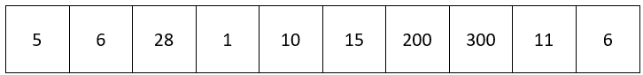
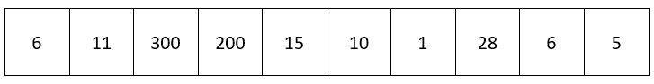
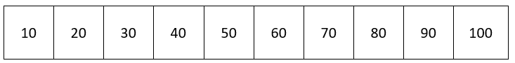
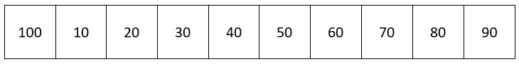
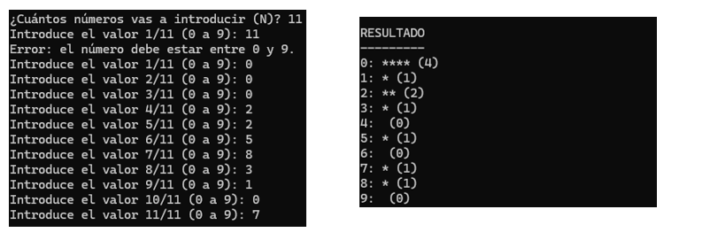
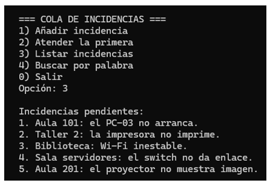

   

 

# Instrucciones generales

- **Entorno:** Visual Studio 2026 (Community). **Proyectos de Consola en C#** (Windows Forms solo si se indica).
- **Alcance del Tema 5:** arrays (vectores), búsqueda/ordenación, validación básica, strings y List<T>.
- **Estilo de código (Microsoft):**
  - Variables y parámetros: **camelCase** (p. ej., precioNeto).
  - Constantes/propiedades: **PascalCase** (p. ej., Iva, TipoCambio).
  - Funciones: PascalCase (p. ej. CalcularPrecioTotal());
  - Controles en Forms: `txtNombre`, `lblResultado`, `btnCalcular`, etc.
- Buenas prácticas exigidas:
  - Evita duplicar código: modulariza lectura, impresión, cálculo y validación cuando tenga sentido
  - Valida entradas (TryParse) cuando se pida lectura segura.
  - Salidas con **cadenas interpoladas y formato** (C2, P1, N0, …) cuando aplique.

 

# Ejercicios con Vectores

## Ejercicio 1. Cargar y mostrar un vector 

Realiza un programa que lea 10 números enteros y los muestre por pantalla usando un array.

## Ejercicio 2. Media de un vector con una función.

Lee un vector de 10 enteros y calcula su media.

La media debe calcularse mediante una función.

## Ejercicio 3. Menor valor del vector.

Lee un vector de 10 enteros y muestra el **menor valor**.

Incluye una función para mostrar el vector y otra que devuelva el menor.

## Ejercicio 4. Vector al revés.

Lee un vector de 10 enteros y genera otro vector con los elementos en orden inverso.
Muestra ambos vectores.

Lo devolverá en otro así:

## Ejercicio 5. Buscar un número y contar repeticiones.

Lee un vector de 10 enteros. Después, pide un número al usuario.

Informa si el número aparece en el vector y:

  - la **primera posición** en la que aparece (si aparece).
  - cuántas veces se repite.
  - si no se encuentra, devolverá la posición -1.
  - Si no aparece, muestra un mensaje claro.
  
## Ejercicio 6. Desplazamiento circular a la derecha.

Lee un vector de 10 enteros y realiza un desplazamiento circular a la derecha.

El último elemento pasará a la primera posición. Utilizar programación modular.

Lo devolverá así:

## Ejercicio 7. Temperaturas de 24 horas.

Introduce las temperaturas de 24 horas en un vector.

Realizar **un subprograma** que permita obtener la temperatura máxima, mínima y la media.

## Ejercicio 8. Ampliación del ejemplo del tema (apartado 5)

Partiendo del ejemplo resuelto del apartado 5 (alumnos + notas con **arrays paralelos**), añade mejoras que NO estén en el ejemplo.

Además, el programa debe incluir una opción para **cargar datos de prueba**:

- Cargar automáticamente un **listado fijo** de alumnos y notas (no aleatorio) para poder hacer pruebas sin escribirlos a mano.
  
Propuestas de mejoras.

- Opción para **modificar** la nota de un alumno existente.
- Opción para **listar solo aprobados / suspensos**.

 

# Ejercicio 9. Integrador 1: Monitor de red (equipos y latencias).

Crea un programa de consola que gestione N equipos de una red (tamaño fijo, recomendado 10).

Usa dos arrays paralelos: uno para la IP (string) y otro para la latencia (int en ms).

El programa tendrá un menú repetitivo con, al menos, estas opciones:

1. Cargar datos manualmente (IP + latencia).
2. Cargar datos automáticamente (para pruebas): generar N equipos con IPs y latencias (valores razonables) sin que el usuario tenga que escribirlos.
3. Listar equipos.
4. Buscar una IP y mostrar su latencia.
5. Mostrar estadísticas: media, mínima y máxima latencia.
6. Ordenar por latencia (de menor a mayor) manteniendo sincronizados ambos arrays.
   
- Valida IP no vacía y latencia >= 0.
  
- Si una IP no existe, el programa debe indicarlo claramente.
  
- No uses List<T> en este integrador: debe ser con **arrays**.
  
**Implementa este integrador solo con las técnicas desarrolladas y usadas en los apuntes, evitando atajos o recursos no aplicados en clase. (p. ej., lambdas, funciones anónimas, LINQ).**

# Ejercicios con Listas

## Ejercicio 10. Copiar y mover pares a otra lista.

Realizar un programa en el que se lea una **lista** de números enteros. Iremos leyendo números y preguntando al usuario si quiere introducir más números. 

Cuando haya terminado de introducir los números haremos dos subprogramas: 

- Un subprograma en el que **copiaremos** en otra lista todos los números pares. 
  
- Otro subprograma en el que pasaremos (**moveremos**) los pares a otra lista de manera que en la primera lista se quedarán únicamente los impares y en la segunda los pares.

## Ejercicio 11. Potencias elemento a elemento.

Realiza un programa en el que se lea una **lista de números Base** y posteriormente una **lista de números Exponente**.

Las listas se leerán de forma dinámica: se irá pidiendo un valor y preguntando al usuario si quiere introducir más.

Después, crea un subprograma que devuelva una tercera lista con las potencias **elemento a elemento**:

resultado[i] = base[i] ^ exponente[i]

Si las listas no tienen la misma longitud, se calcularán potencias **solo hasta la longitud de la lista más corta**.

Muestra las tres listas.

## Ejercicio 12. Intercalar dos listas ordenadas.

Lee dos listas de enteros, ordénalas y crea una tercera lista intercalando elemento a elemento.

La lista final debe quedar ordenada.

  **Ejemplo:**  
  **Lista 1: (1, 4, 8, 8, 10, 20)**  
  **Lista 2: (2, 3, 4, 6, 11, 12, 13)**  
  **Lista 3: (1, 2, 3, 4, 4, 6, 8, 8, 10, 11, 12, 13, 20)**  

## Ejercicio 13. Insertar palabra manteniendo el orden alfabético.

Realizar un programa en el que tengamos una List en el que se van introduciendo palabras, de manera que cada vez que se introduzca una palabra, esta **se inserte en su posición por orden alfabético**. 

La idea es que al introducir el usuario la palabra encontremos en qué posición le tocaría y utilicemos `lista.Insert` para insertarla en la posición que le corresponda. 

Recordad que `String.Compare` es la función que nos permite comparar dos strings alfabéticamente.

 

# Ejercicio 14. Integrador 2: Lotería primitiva.

Realiza un programa de consola que simule el funcionamiento de la lotería primitiva usando dos `List<int>`:

- En una lista se guardarán los 6 números del sorteo (generados de forma aleatoria).
  
- En otra lista se guardarán los 6 números de la apuesta.
- 
El programa tendrá un menú repetitivo con, al menos, estas opciones:

1. **Generar sorteo:** crear 6 números aleatorios entre 1 y 49, sin repetidos.
   
2. **Apuesta manual:** el usuario introduce 6 números entre 1 y 49, sin repetidos.
   
3. **Apuesta automática:** generar una apuesta aleatoria de 6 números entre 1 y 49, sin repetidos
   
4. **Comprobar aciertos:** mostrar cuántos números de la apuesta coinciden con el sorteo.
   
**Implementa este integrador solo con las técnicas desarrolladas y usadas en los apuntes, evitando atajos o recursos no aplicados en clase. (p. ej., lambdas, funciones anónimas, LINQ).**

 

# Ejercicios Extra

## Ejercicio 15. Histograma de frecuencias.

Lee una cantidad de números enteros (todos entre 0 y 9) y muestra cuántas veces aparece cada dígito, representando su frecuencia con asteriscos (*).

## Ejercicio 16. Cola de incidencias (helpdesk)  

Crea un programa que simule una **cola de incidencias** usando una List<string> (cada incidencia es un texto).

El programa mostrará un **menú en bucle** con estas opciones mínimas:

1. **Añadir incidencia** (se añade al final de la lista).
   
2. **Atender la primera** (mostrar y eliminar la incidencia de la posición 0).
   
3. **Listar incidencias** (numeradas, en orden).
   
4. **Buscar por palabra clave** (mostrar las incidencias que contengan la palabra).
   
5. **Salir.**

## Ejercicio 17. El Almacén (Arrays Paralelos y Ordenación)

**Referencia:** Complemento al punto 5 del tema (Vectores de strings y ordenación). Crea un programa para gestionar un pequeño almacén de 5 productos:

- Usa un **Array de strings** para los nombres y un **Array de enteros** para el stock.
  
- Implementa una función que ordene ambos arrays basándose en el stock (de menor a mayor)
  
- **Importante:** Al mover un elemento en el array de stock, debes mover el correspondiente en el de nombres para no perder la relación.
  
- Muestra el inventario ordenado para saber qué productos se están agotando.
  
## Ejercicio 18. Filtro de Datos (Coexistencia de Array y List<T>)

1. Pida al usuario 10 números y los guarde en un Array (tamaño fijo).
   
2. Calcule la media de esos valores.
   
3. Cree una Lista (List<int>) y mueva allí solo los números que estén por encima de la media
   
4. Muestra el Array original y la Lista resultante.
   
## Ejercicio 19. Buscador de "Picos" con Salida Anticipada

**Referencia:** Optimización de búsqueda (Sección 3 de los apuntes). Crea un programa que lea una serie de temperaturas en un Array.

- Implementa una función de búsqueda que devuelva la posición del **primer** valor que supere los 40 grados.

- **Reto:** El bucle debe detenerse inmediatamente (salida anticipada) en cuanto encuentre el valor, sin seguir recorriendo el resto del array innecesariamente. Usa un bool para ello.

